# Diagramas de secuencia del ciclo 1 (versión limpia)

Código PlantUML listo para pegar en draw.io (Organizar > Insertar > Avanzado > PlantUML). Cada bloque es el contenido completo de `sd_CUxx.puml`.

## CU01 Iniciar sesión

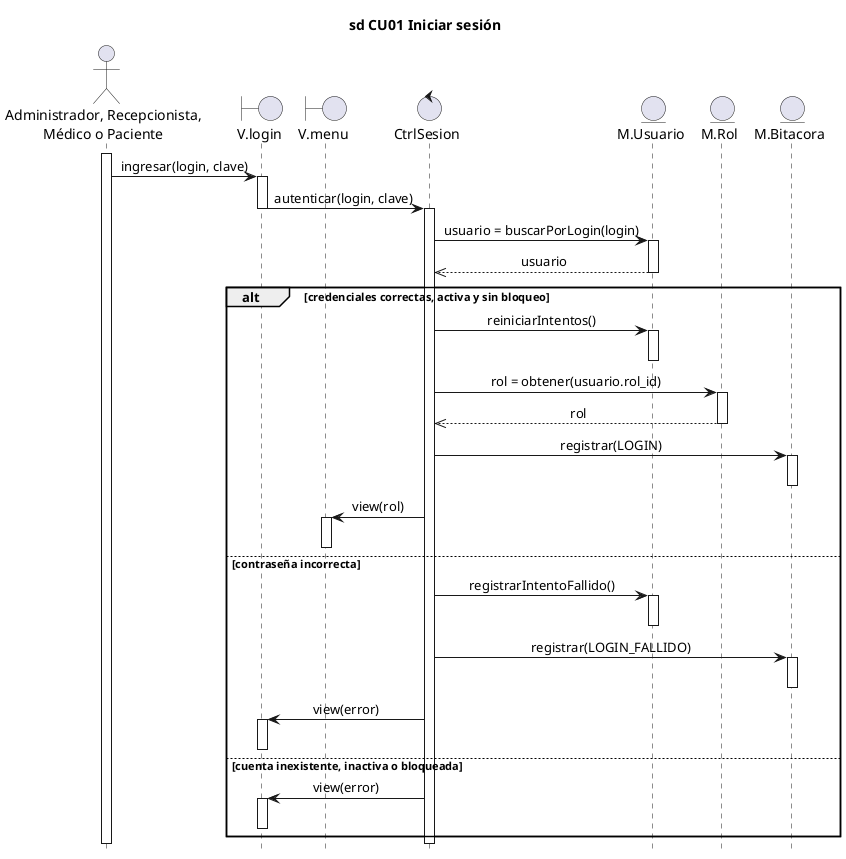

## CU02 Cerrar sesión

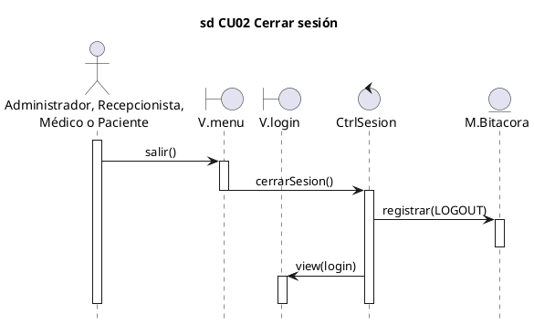

## CU03 Gestionar usuarios y roles

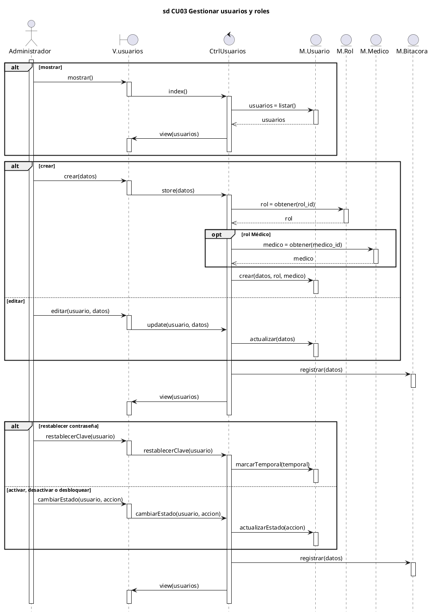

## CU04 Consultar bitácora

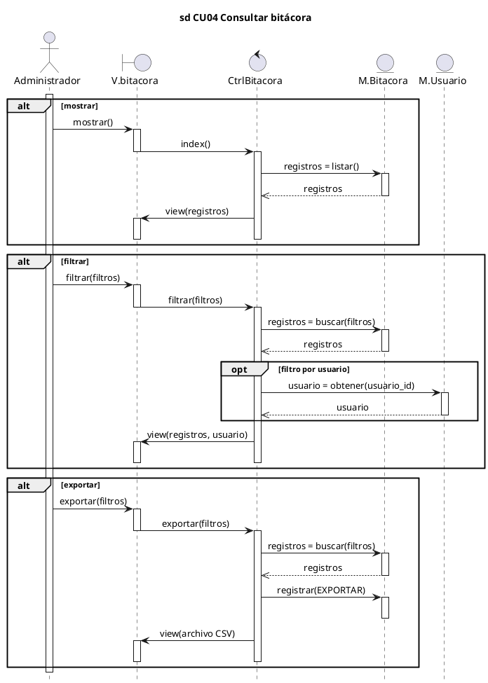

## CU05 Gestionar especialidades

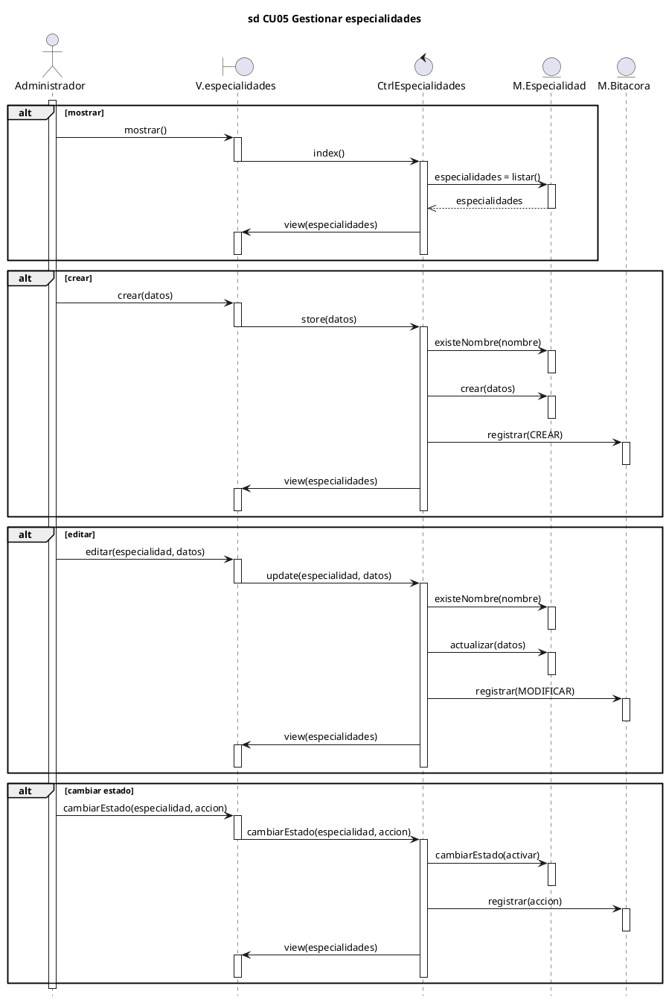

## CU06 Gestionar médicos

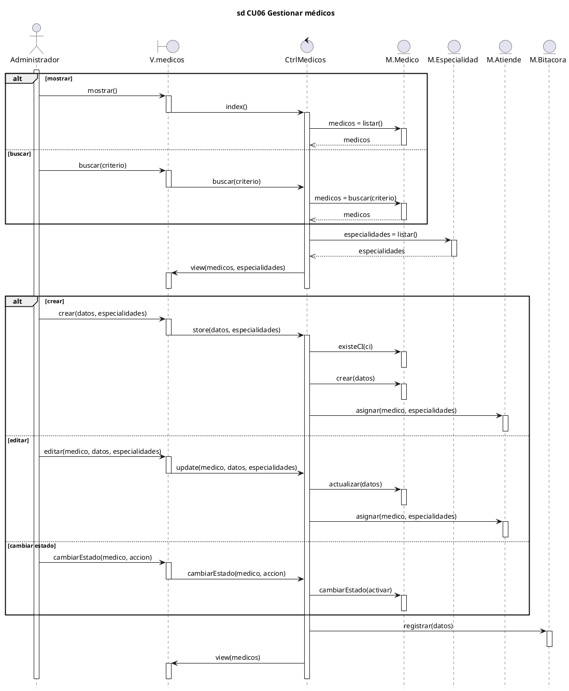

## CU07 Definir horarios de atención

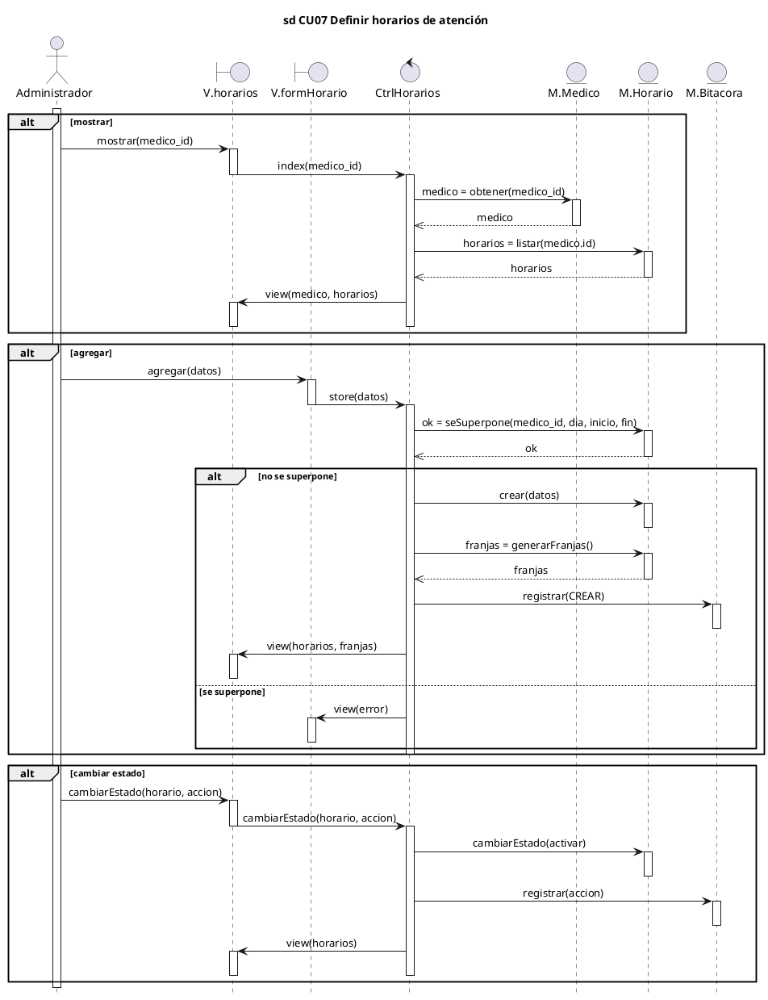

## CU08 Gestionar pacientes

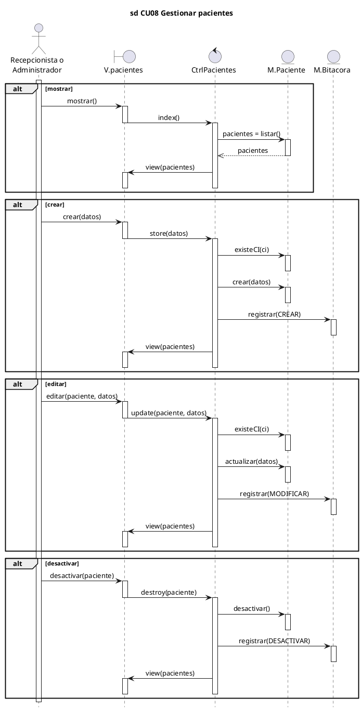

## CU09 Buscar paciente

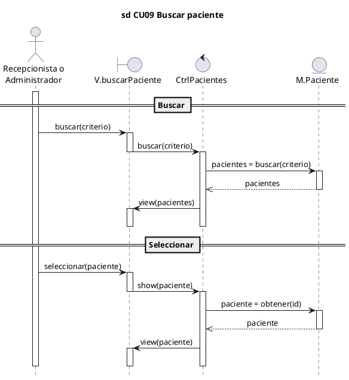

## CU10 Registrarse como paciente

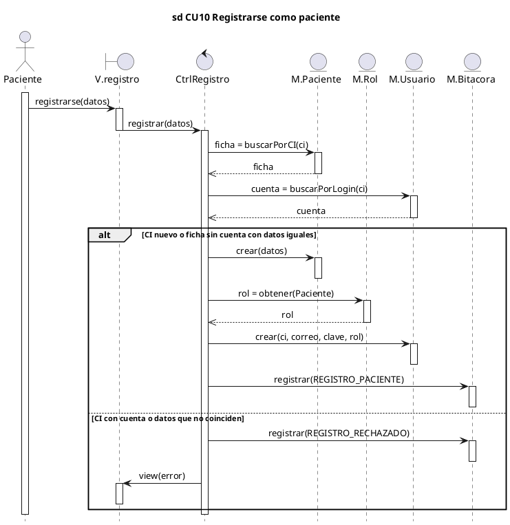

## CU11 Gestionar perfil del paciente

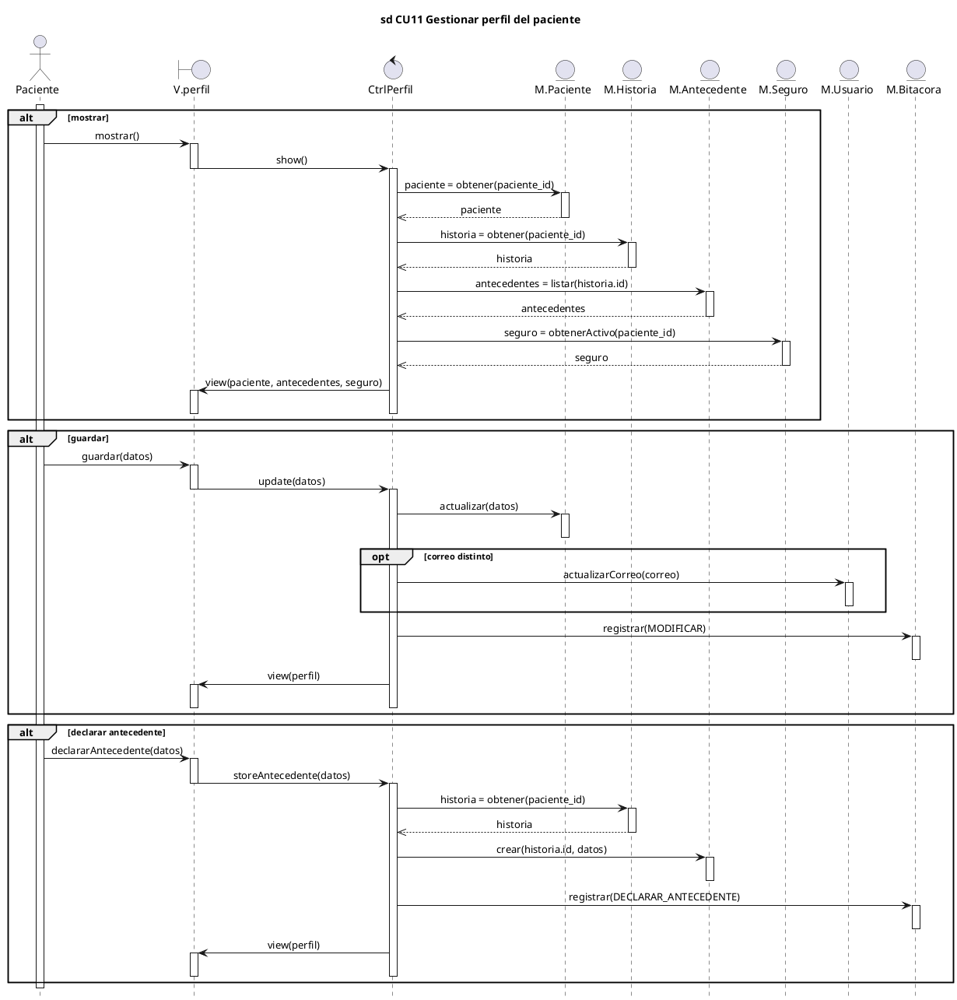

## CU12 Registrar seguro del paciente

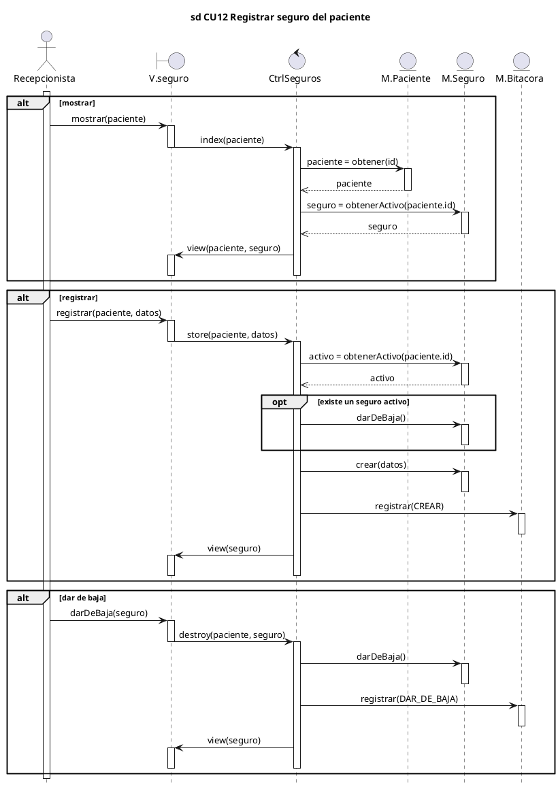

## CU13 Consultar disponibilidad

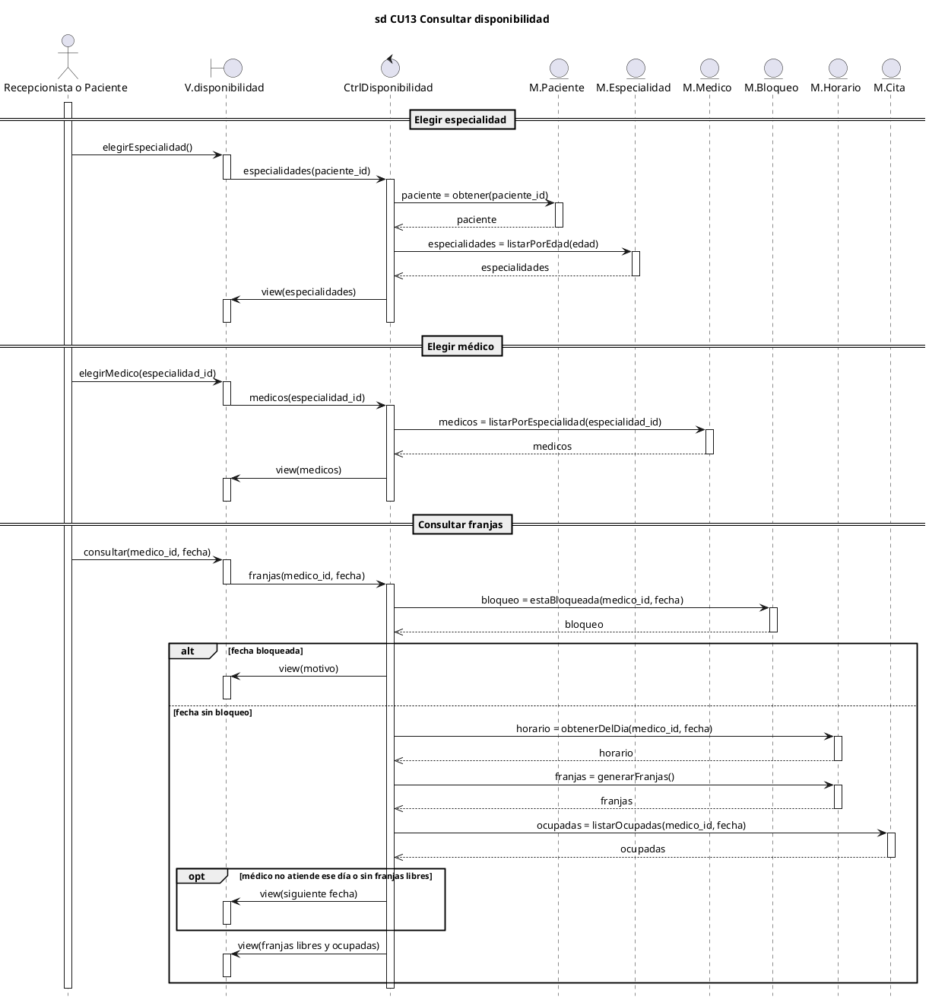

## CU26 Cambiar contraseña

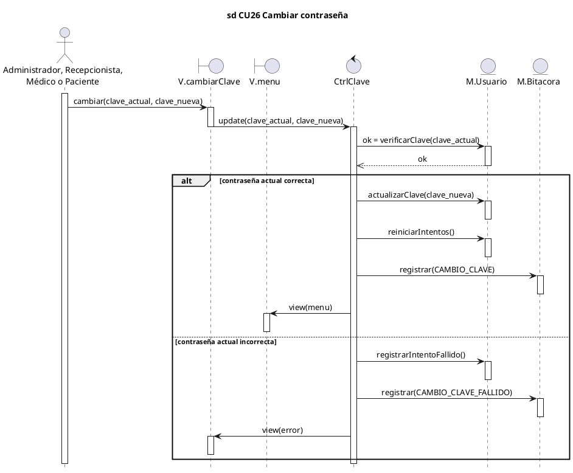

## CU27 Recuperar contraseña

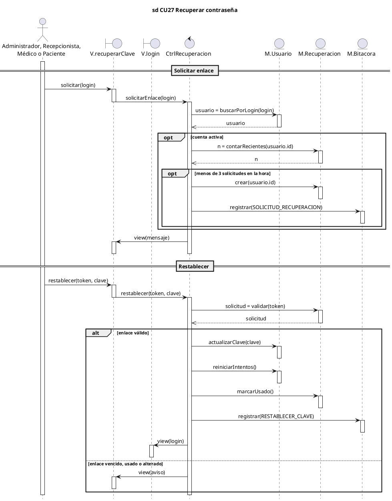
